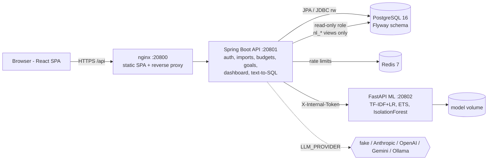
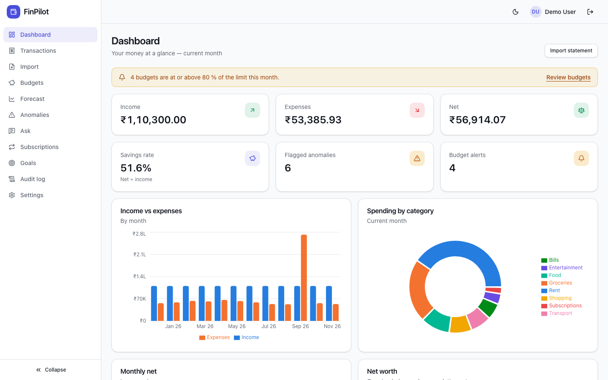
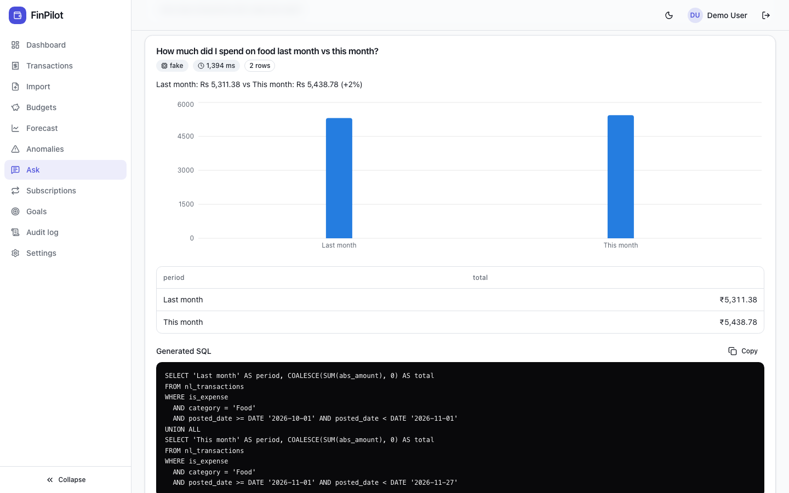
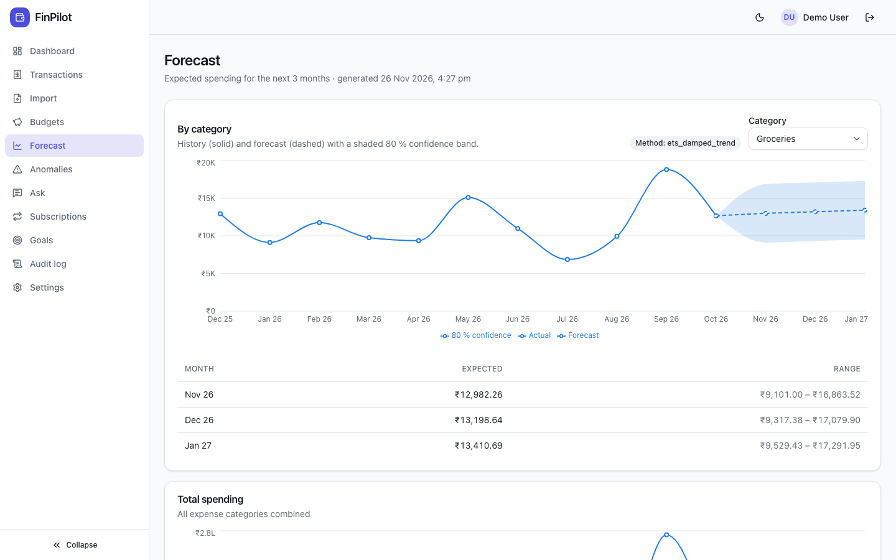
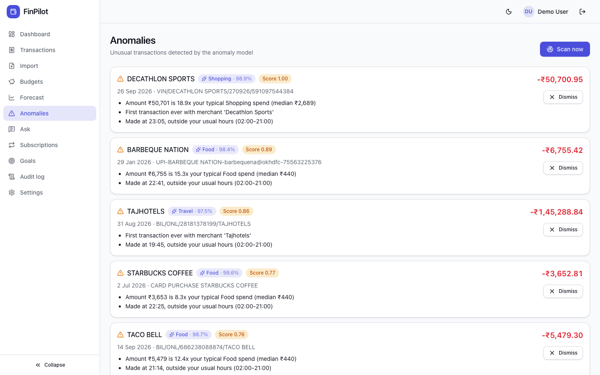
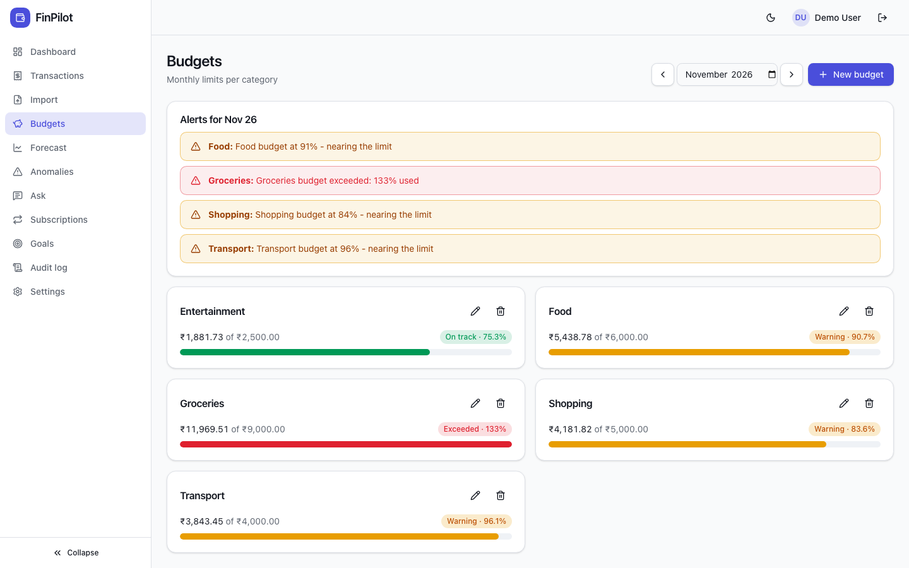
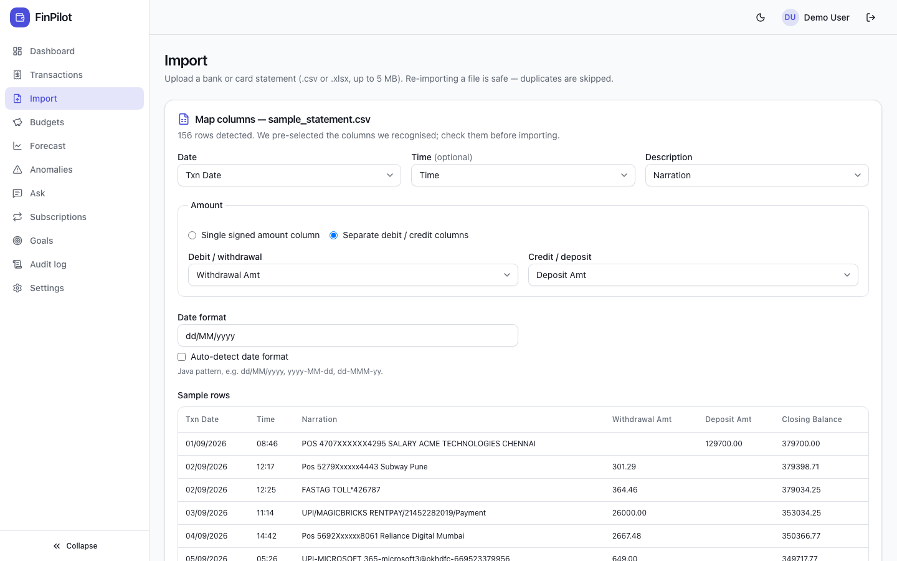
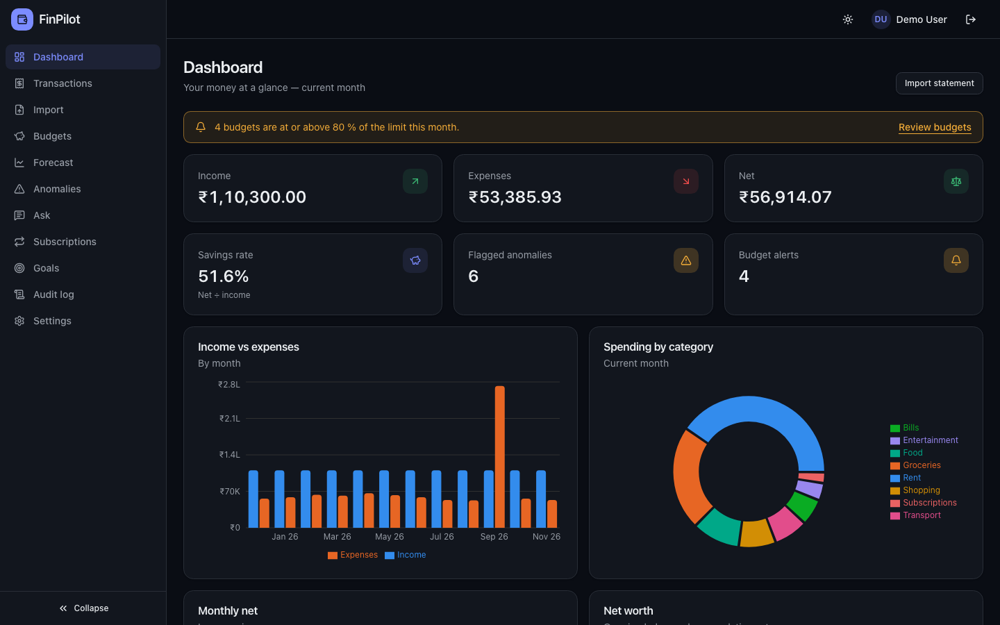

# FinPilot: AI Personal Finance Manager

FinPilot imports bank statements (CSV/Excel), auto-categorises every transaction with an ML model that learns
from your corrections, tracks budgets, forecasts the next three months of spending with confidence intervals,
flags unusual transactions with plain-English explanations, finds subscriptions, plans savings goals, and
answers questions like *"How much did I spend on food last month vs this month?"* with a **safe text-to-SQL
agent** that shows the generated SQL and charts the result.

All data in this repository is **synthetic**. No API key is needed: the default LLM provider is an offline,
deterministic engine, and real providers (Anthropic Claude, OpenAI, Gemini, Ollama) are one env var away.

## Features

| # | Feature | Where |
|---|---|---|
| 1 | CSV / XLSX import with a column-mapping UI (auto-suggested mapping, single amount or debit/credit columns, date-format detection, UTF-8/UTF-16/Windows-1252, `,` `;` tab `|` delimiters, Indian & European number formats) and idempotent de-duplication | `backend/.../importing`, Import page |
| 2 | ML categorisation (13 categories) with confidence; corrections become merchant rules instantly and feed a scheduled retrain (active learning) | `ml/.../categorizer.py`, `RetrainService` |
| 3 | Monthly budgets per category with progress bars and alerts at 80 % / 100 % | Budgets page, `/budgets/alerts` |
| 4 | Dashboard: income vs expense, category breakdown, monthly trend, net worth over time | Dashboard |
| 5 | 3-month forecast per category + total with 80 % prediction intervals (statsmodels ETS) | Forecast page |
| 6 | Anomaly detection (Isolation Forest) with reasons: amount vs category norm, first-time merchant, unusual hour | Anomalies page |
| 7 | Natural-language Q&A: text-to-SQL, SQL validator, read-only DB role, per-user views; SQL + chart/table shown | Ask page |
| 8 | Recurring payment / subscription detection (weekly, monthly, quarterly, yearly) | Subscriptions page |
| 9 | Savings goals with a computed monthly plan, suggested category cuts and AI-written advice | Goals page |
| 10 | Security: JWT + rotating refresh tokens, TOTP 2FA with replay protection, RBAC, AES-GCM encrypted fields, audit log, rate-limited login, lockout, CSP and security headers | `docs/SECURITY.md` |

## Architecture



Text-to-SQL request path: question -> provider proposes SQL -> `SqlValidator` (single SELECT, allow-listed
views and functions, no comments, wrapped in `LIMIT 500`) -> executed as `finpilot_readonly` in a READ ONLY
transaction with `finpilot.user_id` bound -> chart suggestion + summary.

## Tech stack

| Layer | Technology |
|---|---|
| Frontend | React 19, Vite, TypeScript, Tailwind CSS 4, shadcn/ui-style Radix components, TanStack Query + Table, Recharts, Vitest + Testing Library, Playwright |
| Backend | Java 21, Spring Boot 3.5 (Web, Security, Data JPA, Validation, Actuator, Data Redis), Flyway, PostgreSQL 16, Redis 7, springdoc-openapi, JJWT, JSqlParser, Apache POI, Commons CSV, Anthropic Java SDK |
| ML | Python 3.12, FastAPI, scikit-learn, statsmodels, pandas, uv, ruff, mypy (strict), pytest |
| Testing | JUnit 5, Testcontainers (Postgres + Redis), MockMvc, MockWebServer, JaCoCo (70 % gate) |
| DevOps | Docker (non-root images with health checks), Docker Compose, GitHub Actions |

## Screenshots

Captured from the running Docker stack with synthetic demo data (`node scripts/screenshots.mjs`).


*Dashboard: monthly KPIs, budget-alert banner, income vs expenses and spending by category.*


*Ask: a plain-English question answered with validated, read-only SQL, a chart and the result table.*


*Forecast: 12 months of history plus a 3-month ETS forecast with a shaded 80 % confidence band.*


*Anomalies: Isolation Forest flags, each with plain-English reasons.*


*Budgets: progress bars that turn amber at 80 % and red at 100 %.*


*Import: auto-suggested column mapping (debit/credit columns, dd/MM/yyyy dates) for a bank CSV export.*


*Dark mode.*

## Local setup

Prerequisites: Docker Desktop. For development without Docker: JDK 21 + Maven, Python 3.12 + uv, Node 24.

```bash
git clone https://github.com/Adityakumarjha087/finpilot.git && cd finpilot
./infra/gen-env.sh            # writes .env with random secrets (or: cp .env.example .env and edit)
docker compose up -d --build  # postgres, redis, ml, backend, frontend
open http://localhost:20800   # demo@finpilot.dev / DemoPass123!   (admin@finpilot.dev / AdminPass123!)
./scripts/smoke.sh            # scripted end-to-end run of every major feature against the stack
```

| Service | URL |
|---|---|
| Web app | http://localhost:20800 |
| API + Swagger UI | http://localhost:20801/swagger-ui.html |
| ML service | http://localhost:20802/docs |
| PostgreSQL / Redis | localhost:20810 / localhost:20811 |

Development loops:

```bash
# ML service
cd ml && uv sync -p 3.12 && uv run pytest && uv run ruff check . && uv run mypy
uv run python -m finpilot_ml.scripts.evaluate --out ../docs/METRICS.json   # offline metrics
uv run python -m finpilot_ml.scripts.generate_statement --out statement.csv --months 6

# Backend (needs Docker for Testcontainers); without a local JDK use ./infra/mvn.sh instead of mvn
cd backend && mvn verify      # unit + integration tests + JaCoCo report (target/site/jacoco)

# Frontend
cd frontend && npm ci && npm run lint && npm run typecheck && npm test && npm run build
npm run dev                   # http://localhost:20800, proxies /api to :20801
E2E_BASE_URL=http://localhost:20800 npm run test:e2e   # against the running compose stack
```

## Environment variables

| Variable | Default | Purpose |
|---|---|---|
| `POSTGRES_DB` / `POSTGRES_USER` / `POSTGRES_PASSWORD` | finpilot / finpilot / - | Primary database |
| `DB_READONLY_USER` / `DB_READONLY_PASSWORD` | finpilot_readonly / - | Login role for the text-to-SQL assistant (created by Flyway) |
| `JWT_SECRET` | - | HS256 key, >= 32 bytes (startup fails otherwise) |
| `JWT_ACCESS_TTL` / `JWT_REFRESH_TTL` | PT15M / P14D | Token lifetimes (ISO-8601) |
| `FINPILOT_ENCRYPTION_KEY` | - | base64 of 32 bytes for AES-256-GCM field encryption |
| `ML_SERVICE_TOKEN` | - | Shared secret between backend and ML service |
| `LLM_PROVIDER` | fake | `fake`, `anthropic`, `openai`, `gemini`, `ollama` |
| `LLM_MODEL` | provider default | e.g. `claude-opus-5-5` (Anthropic default) |
| `LLM_API_KEY` / `LLM_BASE_URL` | - | Provider credentials / endpoint override |
| `CORS_ALLOWED_ORIGINS` | http://localhost:20800 | Comma-separated allow-list |
| `RATE_LIMIT_LOGIN` / `RATE_LIMIT_API` | 5 / 300 | Per minute |
| `APP_TIMEZONE` | Asia/Kolkata | Month boundaries and assistant dates |
| `SEED_DEMO_DATA` | true | Seed demo + admin users with 12 months of synthetic data |
| `RETRAIN_MIN_CORRECTIONS` / `RETRAIN_CRON` | 5 / every 15 min | Active-learning retrain trigger |
| `LOG_FORMAT` | ecs | Structured JSON logs (`ecs`, `logstash`, `gelf`) |

## API docs

* Swagger UI: http://localhost:20801/swagger-ui.html (OpenAPI JSON at `/v3/api-docs`)
* Human-readable contract: [`docs/API.md`](docs/API.md)

## ML results (synthetic data, `docs/METRICS.json`)

| Model | Metric | Value |
|---|---|---|
| Categoriser | accuracy, seen merchants / new narrations (1 700 rows) | **98.9 %** (macro-F1 0.990) |
| Categoriser | accuracy, **unseen merchants** (merchant-level split, 340 rows) | 54.4 % |
| Active learning | unseen-merchant accuracy after 1 correction per merchant (34) | **54.4 % -> 94.4 %** |
| Categoriser | latency | 30 ms per 1 000 transactions |
| Forecast (ETS) | MAPE, 3-month holdout, 474 category forecasts | 0.21 (naive 3-month mean: 0.205) |
| Forecast | empirical coverage of 80 % interval | 78.5 % |
| Anomaly detection | precision / recall / F1 on 93 injected anomalies (unseen seeds) | 0.84 / 0.98 / 0.91 |

## Test results (last local run)

| Suite | Result |
|---|---|
| Backend (JUnit 5 + Testcontainers Postgres 16 / Redis 7) | 151 tests (30 integration), 0 failures, JaCoCo line coverage 95.9 %, branch 80.5 % |
| ML service (pytest, ruff, mypy --strict) | 21 tests, 81 % coverage, lint and type-check clean |
| Frontend (Vitest + Testing Library, eslint, tsc) | 74 tests, 77 % line coverage, production build OK |
| End to end | `scripts/smoke.sh` and Playwright (`e2e/finpilot.spec.ts`) pass against `docker compose up` |

## Deployment guide

* **Any Docker host / VM:** copy the repo, run `./infra/gen-env.sh` (or provide real secrets through your
  secret manager as env vars), put a TLS-terminating proxy (Caddy, Traefik, ALB) in front of port 20800 and run
  `docker compose up -d`. Flyway migrates on start; Postgres data and models live in named volumes.
* **Managed services:** run the three images (`backend`, `ml`, `frontend`) on ECS / Cloud Run / Fly.io, point
  `DB_URL`, `REDIS_HOST` and `ML_BASE_URL` at managed Postgres 16, Redis and the ML service. The database user
  in `DB_USER` needs `CREATEROLE` once so Flyway can create the read-only role (or pre-create it and grant
  `SELECT` on the `nl_*` views).
* Set `SEED_DEMO_DATA=false`, a real `CORS_ALLOWED_ORIGINS`, and rotate `JWT_SECRET` /
  `FINPILOT_ENCRYPTION_KEY` via your secret store. Note that changing the encryption key makes existing
  encrypted notes / 2FA secrets unreadable.
* CI (`.github/workflows/ci.yml`) lints, type-checks and tests all three services, builds the images, starts
  the stack, and runs the smoke script and Playwright against it.

## What I learned / key engineering decisions

* **LLM SQL is untrusted input.** Validating SQL text is necessary but not enough; the real guarantee comes
  from the database: a role that can only `SELECT` from views that are already filtered to the caller. Tests
  prove the role cannot read base tables or write, even with a malicious query.
* **Offline-first AI makes the system testable.** A deterministic "fake" provider behind the same interface
  lets every test and CI run exercise the full path (generation -> validation -> execution) without keys.
* **Report the honest metric.** In-distribution accuracy (99 %) hides how the model does on merchants it has
  never seen (54 %). That gap is what makes the active-learning loop worth building: one correction per merchant
  lifts it to 94 %, and merchant rules fix the user's own data immediately.
* **Explainable anomalies.** Isolation Forest scores are opaque, so a flag is shown only if a simple rule can
  explain it, which made the alerts precise (0.84) without losing recall.
* **Money is decimal.** `BigDecimal`/`NUMERIC` from CSV parsing to aggregates; tests cover Indian lakh
  separators, European decimals, parentheses negatives and DR/CR suffixes.
* More in [`docs/DECISIONS.md`](docs/DECISIONS.md) and [`docs/SECURITY.md`](docs/SECURITY.md).
